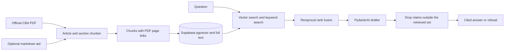

# CBA Copilot

CBA Copilot answers questions about the 2023 NBA Collective Bargaining Agreement. Each claim points at an article, a section, and a page in the official PDF. If the retrieved passages do not support an answer, the app refuses.

A wrong cap answer can change a trade. The validator drops any claim whose passage id is missing from the retrieved set. When retrieval is thin, or every claim is dropped, the response is a refusal rather than a guess.

CBA Copilot is a sibling of document-copilot, cut to this one agreement. SEC filing code is not in this repo.

## Architecture



The demo you can run today stops before Supabase. It searches a small in-memory fixture with a hash embedder and an overlap drafter. The SQL, the migration, and the PydanticAI output type are already in the repo for the live path.

## v1

v1 is one corpus, the July 2023 CBA, in force from 1 July 2023 through the 2029-30 season. The app has a chat shell, citation chips that open the whole source at the anchored passage, and a draft glossary. It does not ingest the full 676-page PDF yet, and it does not call a paid model.

## Later

Compare this edition with a later CBA. Check a proposed trade against the second-apron rules.

## Run the offline demo

Install [uv](https://docs.astral.sh/uv/) and [pnpm](https://pnpm.io/). From `backend/`:

```bash
uv sync --group dev
uv run pytest
uv run python -m evals.runner
uv run uvicorn app.main:app --reload
```

`uv run python -m evals.runner --live` exits before any model call.

From `frontend/`:

```bash
pnpm install
pnpm dev
```

The Vite server proxies `/api` to `http://127.0.0.1:8000`.

## Next for a live index

Create a new Supabase project with [the setup guide](docs/guides/supabase-setup.md). Copy `backend/.env.example` to `backend/.env` and fill it in. Download the official PDF with `python data/download_cba.py`. Do not commit the PDF. The optional article-split markdown is a separate download and is not the source of truth. See [docs/corpus.md](docs/corpus.md).

## Corpus

Source of truth: [nbpa.com/cba](https://nbpa.com/cba). This repo does not include Larry Coon's Salary Cap FAQ, and it does not scrape Hoops Rumors or RealGM.
